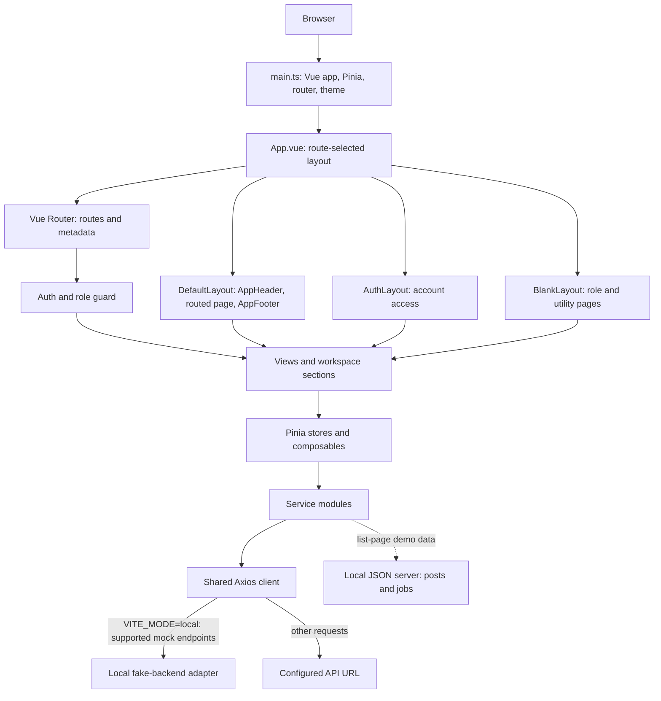

# MediQueue Frontend Visual and Architecture Audit

## Executive summary

The active application is a Vue 3 interface with a clear public-facing identity and
distinct patient, responder, doctor, staff, and administrator workspaces. Its current
state is best described as an **interface prototype with partial local-demo flows**:
most operational screens deliberately show that provider services are not connected,
and the interface must not be mistaken for a live clinical system.

The route table contains 39 route records, including layout parents and redirects, for
35 distinct rendered screens. All 35 screens were checked at 320, 375, 390, 768, 1024,
and 1440 CSS pixels (210 route/viewport checks). The document and body widths did not
exceed the measured viewport at any checked size. Posts and Jobs loaded their local
demo data after the documented JSON server was started.

The most important readiness gap is not visual: authentication, clinical data,
hospital membership, and operational workflows are not backed by a verified
production service. Before real use, the application needs server-enforced
authentication and authorization, connected role-specific services, and end-to-end
validation with synthetic data.

## Scope and method

- The audited application is [`app/`](../../app/), identified as the application root
  by the repository [`README.md`](../../README.md). The sibling
  [`frontend/`](../../frontend/) is a separate Vite prototype and is not included in
  the active route or screen counts.
- Reviewed the route table and guard, app entry point and layouts, design tokens,
  service client and mock adapter, the public pages, role workspaces, and the
  repository's local-demo setup.
- Inspected public pages and role-workspace screens in the browser. Tested route-level
  responsive behavior at all six requested widths. Tested patient navigation on
  mobile, including closing the drawer with Escape.
- Started the documented local JSON server to inspect Posts and Jobs with their demo
  data. This is a local-only dependency, not a production integration.
- Captured screenshots for the public/auth screens and role-workspace sections.
  Profile screenshots that exposed demo-account details were excluded from the final
  gallery.
- No application source was changed for this audit. Existing worktree edits outside
  the audit deliverables were left untouched.

This is a product/UI and architecture review, not a formal accessibility
certification, security assessment, or clinical-safety review.

## Route and screen inventory

The route source of truth is [`routes.ts`](../../app/src/router/routes.ts); route
permissions are implemented by [`guards.ts`](../../app/src/router/guards.ts).

| Area | Routes / screens | Access and observed status |
|---|---|---|
| Public MediQueue pages | `/`, `/how-it-works`, `/features`, `/about`, `/faq`, `/contact` | Public. Clear product messaging describes the interface as in development and says live provider services are not connected. |
| Public template lists | `/posts`, `/jobs` | Public demo lists. Load data from the local JSON server (`npm run mock`); detail pages are guarded. |
| Account access | `/login`, `/signup` | Guest-only auth layout. Local mock login is available. Signup validates input but does not create an account. |
| General authenticated pages | `/home`, `/api`, `/posts/:id`, `/jobs/:id` | Require a demo session. Includes template/demo and API-test surfaces. |
| Patient workspace | `/patient/dashboard`, `/patient/queue`, `/patient/join-queue`, `/patient/emergency`, `/patient/appointments`, `/patient/notifications`, `/patient/history`, `/patient/profile`, `/patient/settings` | Patient role. Queue requests can be prepared in the browser, but no connected hospital service receives them. Appointment and other clinical information is unavailable unless present in the local session. |
| Responder workspace | `/responder/dashboard`, `/responder/emergencies`, `/responder/patients`, `/responder/queue`, `/responder/notifications`, `/responder/history`, `/responder/profile`, `/responder/settings` | Responder role. Sections render service-unavailable or disconnected states; operational records are not live. |
| Doctor workspace | `/doctor/dashboard` | Doctor role. Includes overview, consultation queue, appointments, patient directory, notifications, profile, and settings sections; clinical integration is explicitly pending. |
| Staff workspace | `/staff/dashboard` | Staff role. Provides hospital operations, departments, staff, patients, patient flow, queues, emergencies, notifications, profile, and settings sections. Hospital assignment data is unavailable without its service. |
| Admin workspace | `/admin/dashboard` | Admin role. Includes overview, users, hospitals, departments, medical staff, appointments, queues, emergencies, and settings sections. Operational services are explicitly unavailable. |
| Not found | `/:pathMatch(.*)*` | Blank layout with a 404 and navigation back to the public site. |

The 39 route records include the two role-shell parent records, two redirects, and the
catch-all. Excluding those non-screen records leaves 35 rendered route screens: 15
non-role screens and 20 role screens. Staff, admin, and doctor sections are internal
states of their single dashboard route, not additional router records.

## User-facing capability inventory

| Audience | Interface capability | Current implementation status |
|---|---|---|
| Visitors | Learn about MediQueue, browse FAQs, and navigate to account/contact surfaces | Public presentation pages are available. They accurately disclose that provider services are not connected. |
| Visitors | Contact MediQueue | Form validation exists; message delivery is not connected. The current Contact view does not send a message. |
| Prospective patients | Sign up | The form validates, but there is no registration service or account-creation endpoint. |
| Patients | Prepare a queue request and review queue/appointment information | The UI supports local preparation and empty states. Submission to a hospital and live queue/appointment data are unavailable. |
| Patients | View notifications, history, profile, and preferences | Screens exist, but connected clinical records and delivery services are not available. Some preferences/data are browser-session state and reset on reload. |
| Responders | Review emergency requests, assigned patients, queues, and response history | Workspace navigation and states exist; the operational service is not connected. |
| Doctors | Review consultation queue, appointments, and patient directory | Preview screens exist; clinical service integration and permissions are pending. |
| Hospital staff | Review hospital operations, patient flow, queues, emergencies, departments, and staff | Preview sections exist; assignment and operational data services are unavailable. |
| Administrators | Review users, hospitals, departments, staff, appointments, queues, emergencies, and settings | Preview sections exist; authorized administration services are unavailable. |
| Demo users | Browse Posts and Jobs; open protected detail pages | Lists use the local JSON server. Detail routes require a demo session. |

The UI explicitly says MediQueue does not dispatch emergency services and does not
replace emergency care or clinical advice. This is appropriate for the current
non-integrated prototype; it should remain prominent until any future emergency
workflow is designed, verified, and safely connected.

## Application architecture

- [`main.ts`](../../app/src/main.ts) creates the Vue app, installs Pinia and the
  router, initializes the theme, and mounts the app.
- [`App.vue`](../../app/src/App.vue) selects a default, auth, or blank layout from
  route metadata and renders the routed component.
- [`DefaultLayout.vue`](../../app/src/layouts/DefaultLayout.vue) centralizes the
  public header and shared footer. Auth pages use their own layout; patient/responder
  and staff/doctor/admin workspaces use role-specific shells or blank layout
  metadata.
- [`client.ts`](../../app/src/services/http/client.ts) is the HTTP boundary.
  Local mode installs [`fake-backend.ts`](../../app/src/mocks/fake-backend.ts), which
  handles supported demo endpoints and lets other requests fall through to the
  configured API URL. Posts and Jobs require the separate local JSON server.
- Route guards use persisted browser session state and role metadata to shape
  navigation. They are client-side demo controls, not production authorization.

### Repository structure and stack

The active `app/src` tree contains 74 Vue files, 64 TypeScript files, 2 JavaScript
files, 7 CSS files, and 30 `.spec.ts` files (counts include tests).

| Concern | Implementation |
|---|---|
| UI | Vue 3 single-file components, TypeScript |
| Navigation | Vue Router with lazy-loaded views and route metadata |
| State | Pinia, composables, browser storage for selected demo state |
| HTTP | Shared Axios client; local fake adapter and configured API fallback |
| Styling | Tailwind CSS 4 plus shared CSS tokens and scoped component styles |
| Validation | Vuelidate |
| Tests / tooling | Vitest, Vue Test Utils, ESLint, Prettier, `vue-tsc`, Vite |
| Demo content | `json-server` for Posts and Jobs |

The dependency version ranges are in [`app/package.json`](../../app/package.json).
The sibling [`frontend/package.json`](../../frontend/package.json) belongs to a
separate prototype and should not be treated as the active app's dependency manifest.

## Design system and visual observations

The shared palette is defined in
[`tailwind.css`](../../app/src/assets/styles/tailwind.css). Public pages use the same
navy, green, white, and neutral family shown in the Features page.

| Token / use | Value |
|---|---|
| Deep navy / brand 900 | `#17324f` |
| Caribbean green / brand 500, 600, and solid | `#087f72` |
| Darker green / brand 700 and hover | `#06685e` |
| Light green surfaces | `#effaf7`, `#d9f3ec`, `#b8e6d9` |
| Main light background | `#f3f6f8` |
| White surface | `#ffffff` |
| Primary text | `#1e2d3d` |
| Secondary text | `#5f6f7d` |
| Neutral border | `#dfe6eb` |
| Font stack | UI sans-serif, system UI, Segoe UI, Roboto, sans-serif |

Dark mode supplies corresponding navy surfaces and lighter text/brand values. The
global stylesheet applies a consistent `:focus-visible` outline and defines shared
`.page` and `.page-narrow` gutters. Auth screens intentionally use a standalone visual
layout while retaining the same core brand colors.

### Strengths

- The redesigned Features page sets a clear visual reference: readable typography,
  restrained green accents, generous white space, and explicit availability messaging.
- Public content explains what is currently unavailable rather than promising live
  queues, appointments, or hospital records.
- Public pages share one footer; its Explore and Patient Services links are exposed as
  separate navigation links with correct route destinations. There are no Privacy or
  Terms routes in the route table, so none were invented in the footer.
- Role workspaces use distinct navigation labels and show explicit disconnected/
  unavailable states instead of fabricated operational records.
- Patient and admin layouts include skip-to-main links; public navigation and
  workspace controls expose accessible names in the inspected browser tree.

### Opportunities

- Some sampled icon/theme controls have a 36px minimum dimension in the shared
  stylesheet. This is usable, but smaller than the commonly recommended 44px touch
  target; increase high-frequency mobile controls where layout permits.
- Keyboard focus is globally visible, but a formal screen-reader and WCAG conformance
  pass has not been performed. Test focus order, dialogs, menu state announcements,
  form errors, and data tables as those workflows mature.
- Keep unavailable/empty/error states visually distinct and consistent across all
  workspace sections when the APIs are introduced. A view that currently says
  “unavailable” must not silently become success-shaped when a service fails.

## Responsive and browser verification

Tested CSS viewport widths: **320, 375, 390, 768, 1024, and 1440 px**, each at a
900px viewport height. For every route, the browser-reported viewport matched the
requested width. At each size, checked `document.documentElement.scrollWidth` and
`document.body.scrollWidth` against the actual viewport width.

| Screen group | Routes checked | Widths | Horizontal overflow |
|---|---:|---|---|
| Public, demo-list, and account pages | 10 | All six | None |
| Patient workspace | 9 | All six | None |
| Responder workspace | 8 | All six | None |
| Doctor, staff, and admin workspaces | 3 | All six | None |
| General authenticated pages and 404 | 5 | All six | None |
| **Total** | **35** | **210 route/viewport checks** | **None observed** |

The route-level sweep covers the 35 routed screens. Doctor, staff, and admin have
additional internal sections inside their dashboard routes; those sections were
visually inspected and captured, but were not each independently swept at all six
widths. Patient mobile navigation was opened and closed with Escape. Posts and Jobs
were rechecked with the documented local JSON server running.

## Findings and recommended priorities

| Priority | Finding | Recommendation |
|---|---|---|
| P0 — before production use | Route permissions live in browser-side guards, and the local fake backend is not a trusted identity or authorization boundary. | Implement server-issued sessions and enforce role, hospital membership, and data permissions on the backend. Do not rely on Vue route metadata to protect clinical or operational data. |
| P0 — before clinical workflows | Queue submission, appointments, patient records, notifications, responder operations, and admin/staff data are not connected to verified provider services. | Define and integrate the service/API contracts, validation rules, audit trail, loading/error states, and authorization for each workflow before representing it as live. |
| P1 | Signup validates but does not create accounts; Contact validates but does not send messages. | Connect approved registration and contact services or keep the current explanatory notices and ensure submit actions cannot imply success. |
| P1 | Staff assignment lookup logs a service-unavailable error; administrator operational data is unavailable. Doctor and responder screens also announce pending integrations. | Provide service health and explicit retry/recovery behavior; preserve honest unavailable states until the service is ready. |
| P2 | Posts and Jobs depend on an optional local JSON server. | Document the prerequisite in developer setup and ensure production builds use an intentional API or a clear unavailable state, not an accidental failed request. |
| P2 | Several shared icon/theme controls are smaller than a 44px comfort target. | Audit control dimensions and spacing on narrow screens; enlarge the controls that are hard to activate without causing overflow. |
| P2 | This review did not certify accessibility or clinical safety. | Perform a dedicated keyboard/screen-reader review and a clinical-safety review before any real-world deployment. |
| P3 | The repository contains both the active `app/` and a separate `frontend/` prototype. | Keep ownership and build/deployment scope explicit so future changes are not applied to the wrong application. |

## Screenshot index

The screenshot gallery is under [`screenshots/`](./screenshots/). It contains **48
screenshots**. The four signed-in profile captures were intentionally omitted to avoid
including demo-account identity details.

### Public and account pages

- [Landing](./screenshots/public/landing.png)
- [About](./screenshots/public/about.png)
- [Features](./screenshots/public/features.png)
- [How it works](./screenshots/public/how-it-works.png)
- [Contact](./screenshots/public/contact.png)
- [FAQs](./screenshots/public/faq.png)
- [Login](./screenshots/public/login.png)
- [Signup](./screenshots/public/signup.png)
- [Posts](./screenshots/public/posts.png)
- [Jobs](./screenshots/public/jobs.png)

### Patient workspace

- [Dashboard](./screenshots/roles/patient-dashboard.png)
- [Queue](./screenshots/roles/patient-queue.png)
- [Prepare queue request](./screenshots/roles/patient-join-queue.png)
- [Emergency](./screenshots/roles/patient-emergency.png)
- [Appointments](./screenshots/roles/patient-appointments.png)
- [Notifications](./screenshots/roles/patient-notifications.png)
- [History](./screenshots/roles/patient-history.png)
- [Settings](./screenshots/roles/patient-settings.png)

### Responder workspace

- [Dashboard](./screenshots/roles/responder-dashboard.png)
- [Emergencies](./screenshots/roles/responder-emergencies.png)
- [Patients](./screenshots/roles/responder-patients.png)
- [Queue](./screenshots/roles/responder-queue.png)
- [Notifications](./screenshots/roles/responder-notifications.png)
- [History](./screenshots/roles/responder-history.png)
- [Settings](./screenshots/roles/responder-settings.png)

### Doctor workspace

- [Overview](./screenshots/roles/doctor-overview.png)
- [Appointments](./screenshots/roles/doctor-appointments.png)
- [Patient directory](./screenshots/roles/doctor-patient-directory.png)
- [Notifications](./screenshots/roles/doctor-notifications.png)
- [Settings](./screenshots/roles/doctor-settings.png)

### Staff workspace

- [Operations](./screenshots/roles/staff-operations.png)
- [Departments](./screenshots/roles/staff-departments.png)
- [Medical staff](./screenshots/roles/staff-medical-staff.png)
- [Patients](./screenshots/roles/staff-patients.png)
- [Patient flow](./screenshots/roles/staff-patient-flow.png)
- [Queue](./screenshots/roles/staff-queue.png)
- [Emergency](./screenshots/roles/staff-emergency.png)
- [Notifications](./screenshots/roles/staff-notifications.png)
- [Settings](./screenshots/roles/staff-settings.png)

### Admin workspace

- [Overview](./screenshots/roles/admin-overview.png)
- [Users](./screenshots/roles/admin-users.png)
- [Hospitals](./screenshots/roles/admin-hospitals.png)
- [Departments](./screenshots/roles/admin-departments.png)
- [Medical staff](./screenshots/roles/admin-medical-staff.png)
- [Appointments](./screenshots/roles/admin-appointments.png)
- [Queues](./screenshots/roles/admin-queues.png)
- [Emergencies](./screenshots/roles/admin-emergencies.png)
- [Settings](./screenshots/roles/admin-settings.png)

## Verification limits and audit artifacts

- This documentation-only audit did not rerun unit tests, ESLint, Prettier, typecheck,
  or a production build. Earlier footer-focused changes have their own validation
  history; those results are not a substitute for a fresh full-app test run.
- Browser checks used the local Vite application and local demo services. They do not
  establish production API availability, server authorization, real-data behavior,
  or clinical suitability.
- A temporary unauthorized response during an initial synthetic-session probe was
  caused by that probe's invalid token. The protected-route checks were rerun with a
  valid local demo session; the probe response is not counted as an application
  finding.
- The observed staff hospital-assignment service error and the explicitly
  unavailable doctor/responder/admin states remain visible findings. They were not
  hidden or rewritten as successful workflows.
- The source of route access and behavior is
  [`routes.ts`](../../app/src/router/routes.ts),
  [`guards.ts`](../../app/src/router/guards.ts), and the
  [`README.md`](../../README.md) local-demo and deployment notes.
